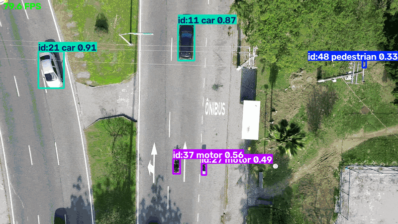
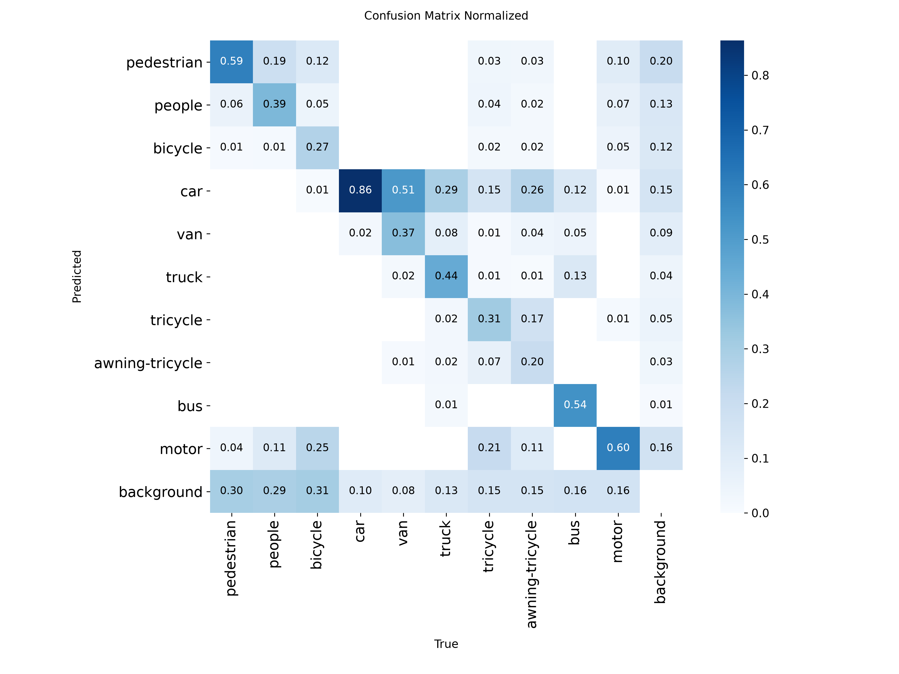
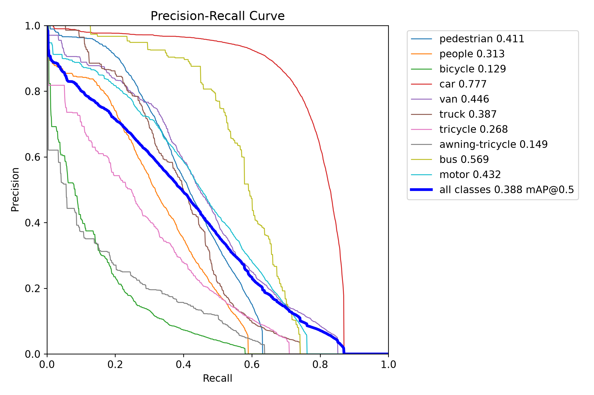
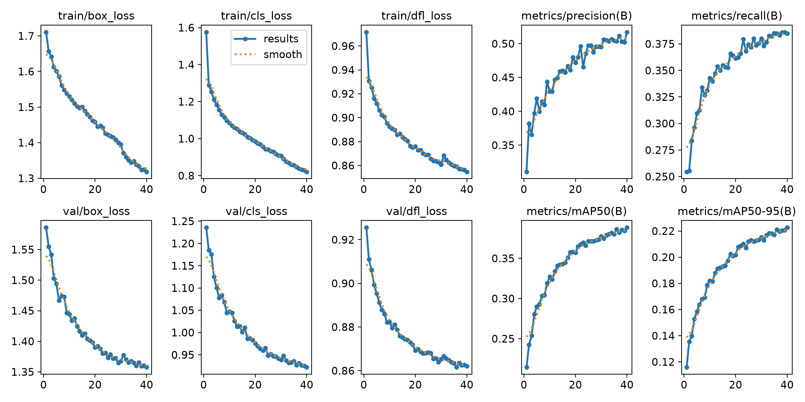

# Drone-View Object Detection & Tracking (YOLOv8 + OpenCV + ONNX)

Fine-tuned YOLOv8s on VisDrone aerial imagery, built an OpenCV + ByteTrack video pipeline, exported to ONNX, and tested how input resolution affects small-object detection.
The tracking pipeline is packaged with Docker (CPU image) so it runs with one command.

**Not done (on purpose, see Limitations):** Jetson / Raspberry Pi deployment, INT8 quantization, TensorRT, tracker tuning, GPU support inside Docker.



## Run with Docker

You need Docker (Docker Desktop on Windows or Mac). The image is CPU-only, so no GPU or CUDA setup is needed. The trained model (`weights/best.pt`, model A below) is included in the repo.

```
# 1. Put a video in a videos/ folder (any .mp4, for example videos/drone.mp4)
mkdir videos

# 2. Build the image (the first build downloads PyTorch and takes several minutes)
docker build -t drone-tracker .

# 3. Run it
docker run --rm -v "$(pwd)/videos:/videos" drone-tracker /videos/drone.mp4 640
```

On Windows PowerShell, use `${PWD}` instead of `$(pwd)`.

- **Arguments:** `<video> <imgsz>`, the same as `track_video.py`. With no arguments the container runs `/videos/drone.mp4` at 640.
- **Output:** the tracked video is saved next to the input, for example `videos/drone_tracked_640.mp4`.
- **Other weights:** mount a folder and point `MODEL_PATH` at the file, for example `-v "$(pwd)/my_weights:/models" -e MODEL_PATH=/models/best.pt`.
- **Speed:** CPU only, so it is much slower than the GPU numbers below. On the day clip at 640 the container ran at 77.0 ms/frame (13.0 FPS), see the video pipeline table.

## Results

Trained on VisDrone2019-DET train (6,471 images), 10 classes. All numbers below are on the held-out **test-dev** split (1,610 images, 75,102 instances), because checkpoints were selected on val.

| Model | Eval imgsz | Precision | Recall | mAP50 | mAP50-95 |
|---|---|---|---|---|---|
| A. YOLOv8s fine-tuned at 640 (40 epochs) | 640 | 0.443 | 0.344 | 0.312 | 0.176 |
| A. same model, no retraining | 960 | 0.494 | 0.404 | 0.379 | 0.219 |
| **B. A + 15 more epochs at 960** | 960 | **0.493** | **0.408** | **0.382** | **0.222** |

Val (used for checkpoint selection), model A at 640: mAP50 0.379, mAP50-95 0.220.

### Resolution experiment

Failure analysis (below) pointed to input resolution as the main limit on small objects, so I tested it two ways:

1. **Run the existing 640-trained model at 960 with no retraining:** mAP50 0.312 to 0.379 (+0.067), mAP50-95 0.176 to 0.219.
2. **Fine-tune 15 more epochs at 960:** only +0.003 mAP50 and +0.003 mAP50-95 on top of that, which is within what I would expect from run-to-run noise (single run, no seeds repeated).

Takeaway: almost all of the gain came from inference resolution alone. Fine-tuning at 960 added very little. Caveat: model B differs from the 960-inference run of model A by both resolution and 15 extra epochs, so +0.003 is an upper bound on the effect of training at 960 specifically.

Per-class test-dev mAP50:

| Class | Instances | A @640 | A @960 | B @960 |
|---|---|---|---|---|
| car | 28,074 | 0.709 | 0.786 | 0.786 |
| bus | 2,940 | 0.550 | 0.598 | 0.599 |
| truck | 2,659 | 0.377 | 0.457 | 0.447 |
| van | 5,771 | 0.355 | 0.430 | 0.429 |
| motor | 5,845 | 0.288 | 0.385 | 0.393 |
| pedestrian | 21,006 | 0.257 | 0.357 | 0.361 |
| tricycle | 530 | 0.181 | 0.231 | 0.238 |
| awning-tricycle | 599 | 0.177 | 0.215 | 0.220 |
| people | 6,376 | 0.134 | 0.182 | 0.195 |
| bicycle | 1,302 | 0.0944 | 0.150 | 0.148 |

Small-object classes improved most in relative terms (pedestrian +39%, bicycle +59%, people +36% from A @640 to A @960), but their absolute recall is still low (bicycle recall 0.111 to 0.186, people 0.122 to 0.167). Resolution helped; it did not remove the problem.

The test split is harder than val (more instances per image, up to 461 objects in one image), so the val-to-test gap for model A at 640 is expected.

## Speed / export

All speed numbers in this section are for model A at 640.

ONNX export preserved accuracy: test-dev mAP50 **0.312** and mAP50-95 **0.176**, identical to PyTorch to three decimals.

Latency, 640x640, batch 1, 90 measured images after 10 warmup, `conf=0.22`, single run (`bench.py`):

| Model | Device | Inference ms | Total ms (pre+inf+post) | FPS |
|---|---|---|---|---|
| PyTorch FP32 | CPU | 159.2 | 162.4 | 6.2 |
| ONNX Runtime FP32 | CPU | 84.2 | 91.1 | 11.0 |
| PyTorch FP32 | RTX 3050 6GB laptop GPU | 7.0 | 9.4 | 105.8 |

ONNX Runtime was about 1.8x faster than PyTorch on the same CPU. The GPU row is a reference only; the CPU-vs-CPU comparison is the fair export comparison. A laptop CPU is a rough proxy for a CPU-only edge board, not a substitute for testing on one.

I did **not** benchmark latency at 960 with this protocol. The validation-script timings (6.3 ms/image at 640 vs 15.8 ms at 960) used different batch sizes, so they are not comparable; expect 960 to cost noticeably more than 640.

Video pipeline (`track_video.py`): YOLOv8s (model A) + ByteTrack, frames resized to 1280x720 first. Timing covers `model.track` only, not decoding, drawing or writing.

| Clip | imgsz | ms/frame | FPS |
|---|---|---|---|
| Day, 1080p60 (1,452 frames) | 640 | 12.8 | 77.9 |
| Night, 4K30 (725 frames) | 640 | 16.0 | 62.7 |
| Night, 4K30 | 1280 | 34.2 | 29.2 |

Inference at 1280 cost about 2.1x the latency of 640 on the same clip.

## Failure analysis

From the confusion matrices and PR curves (model A, val split):

1. **Misses dominate.** About 35% of pedestrians, 34% of "people" and 39% of bicycles are predicted as background, against 12% of cars.
2. **Recall ceiling on small classes.** Bicycle and awning-tricycle PR curves stop at roughly 0.43 and 0.49 recall even at near-zero confidence. VisDrone images are about 2000px wide and training at 640 discards small-object detail. The resolution experiment above supports this: higher input resolution raised mAP substantially, though not enough to close the gap.
3. **Class imbalance.** Car has 14,064 val instances; bicycle has 1,287 and awning-tricycle 532. AP roughly tracks instance count.
4. **Similar classes get confused.** About 50% of vans are predicted as car and 28% of trucks. Some "people" are predicted as "pedestrian" and bicycles as motor. Part of this is label ambiguity, not only model error.
5. **Crowded scenes** (plazas) produce heavy box overlap.
6. **False positives on small thin objects.** In the demo clips, a utility pole was boxed as a pedestrian (0.49) and a tiny pedestrian box (0.25) appeared on grass. One white van was labelled truck.

Operating point: the F1-confidence curve peaks at 0.43 at confidence 0.215, so demos use `conf=0.22`.







## Qualitative notes

- **Day clip:** cars and the bus are boxed cleanly at roughly 0.8-0.9 confidence. Frames with no vehicles are empty apart from occasional small false positives.
- **Night clip:** many cars are detected, but track IDs fragment and class labels flicker (the same object flips between truck and van). The model was trained on daytime imagery only, so this is a stress test, not a result. The unique-ID counts printed by the script (78 day, 465 night at 640, 514 night at 1280) are **not** accuracy metrics: ID switches inflate them, and ByteTrack's ID counter also advances on tracks that are never shown.The day clip gave 82 IDs in the CPU Docker run versus 78 on the GPU, which shows how unstable this count is.
- I did not measure a miss rate on the demo clips; only a handful of frames were inspected by eye. Demo clips were run with model A, not model B.

## Limitations

- No Jetson or Raspberry Pi testing. CPU numbers are a proxy only.
- No INT8 quantization or TensorRT.
- The tracker is untuned (default ByteTrack config).
- ONNX export, CPU benchmarks and video demos use model A at 640; model B and 960 inference were evaluated for accuracy only.
- The 960 fine-tune is not a controlled experiment (resolution and 15 extra epochs change together), and every result is a single run with no variance reported.
- Demo clips are stock footage with a different camera angle and, for one, a night domain far from VisDrone's training data.

## Future work

Tile images (SAHI) or add a P2 detection head for small objects, rebalance or merge ambiguous classes, benchmark 960 latency properly, quantize to INT8 and test on real edge hardware, add GPU support to the Docker image.

## Reproduce

```
python -m venv .venv
.\.venv\Scripts\Activate.ps1
pip install -r requirements.txt
# install the CUDA build of torch from pytorch.org if training on GPU

# model A
yolo detect train data=VisDrone.yaml model=yolov8s.pt epochs=40 imgsz=640 batch=8 workers=0 project=runs name=visdrone_s
yolo detect val model=<path>\best.pt data=VisDrone.yaml split=test
yolo detect val model=<path>\best.pt data=VisDrone.yaml split=test imgsz=960 batch=4

# model B (resolution fine-tune)
yolo detect train model=<path to A>\best.pt data=VisDrone.yaml epochs=15 imgsz=960 batch=4 workers=0 project=runs name=visdrone_s_960
yolo detect val model=<path to B>\best.pt data=VisDrone.yaml split=test imgsz=960 batch=4

# export, benchmark, video
yolo export model=<path>\best.pt format=onnx imgsz=640
python bench.py
python track_video.py <video.mp4> 640
```

Environment: Ultralytics 8.4.189, Python 3.13, torch 2.11 (CUDA 12.8), RTX 3050 6GB laptop GPU. Dataset: VisDrone2019-DET (downloaded by Ultralytics). Demo footage is third-party stock video; check its license before redistributing.

`track_video.py` and `bench.py` contain a local path to the trained weights (`runs\detect\runs\visdrone_s\weights\`). Edit it to point at your own `best.pt` / `best.onnx`.

## Repository contents

```
README.md
Dockerfile          # CPU-only image that runs track_video.py          
.dockerignore       # keeps videos, datasets and training runs out     
track_video.py
bench.py
requirements.txt
weights/best.pt     # model A (YOLOv8s fine-tuned at 640)               
docs/

```

Datasets, training runs and videos are not committed.

## License

Ultralytics YOLO is licensed under AGPL-3.0, so this repository is released under AGPL-3.0 as well.